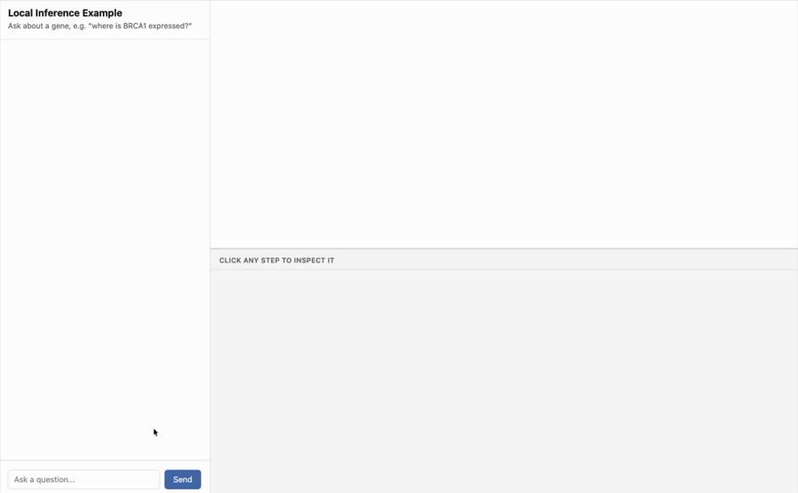
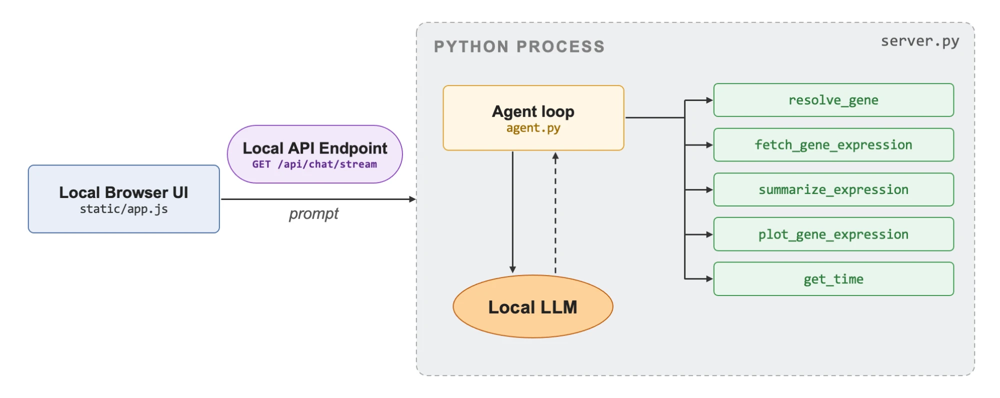
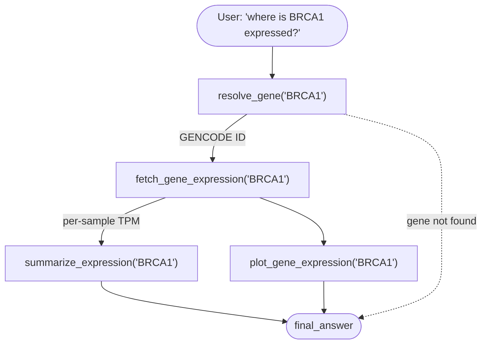
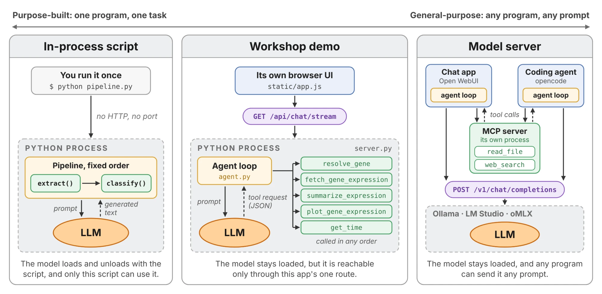

# Local Inference Example

This is a hands-on demo that downloads a small open-weight model from
Hugging Face, runs it entirely on your own laptop, and wraps it in a
minimal tool-using ("agentic") loop that calls a real public
bioinformatics API, with a browser UI so you can watch it work.

Running the model locally instead of calling a hosted API has a few
practical advantages here. After the first download the model itself
needs no internet connection, so it keeps working offline (only the
tools' calls to the public GTEx API need a connection). Your prompts and
the model's reasoning stay on your laptop, so there's no API key and no
request log sitting on someone else's server. Because the weights are
open, you can actually inspect every prompt, step, and tool call the
model produces, rather than treating it as a black box. And because
nothing here depends on a vendor's API, you can swap the model, edit a
tool's schema, or change the prompt directly. Running the model itself
also costs nothing beyond the electricity to run your laptop: there's no
per-token or per-request charge, no matter how many questions you ask.

It works on macOS and Windows/Linux, and runs on CPU only by default.

## Quickstart

Requires [uv](https://docs.astral.sh/uv/getting-started/installation/)
(works the same on macOS and Windows).

```bash
git clone git@github.com:ccb-hms/local-inference-example.git
cd local-inference-example
uv sync
uv run local-inference-example
```

`uv run` downloads the model before it opens the browser (~7GB, cached
under `~/.cache/huggingface` for next time), with a progress bar so you can
watch how long it's got left. After that, http://127.0.0.1:8000 opens with
the model already loaded and ready to answer. Every question still needs
internet, since the tools query GTEx live.

## What it does

There's a chat panel on the left and a chart panel on the right. Ask about
a gene (e.g. *"where is BRCA1 expressed?"*) and the model, running
entirely on your laptop, decides which tools to call, in what order, to
answer you. Every
tool call and its result is narrated into the chat *as it actually
happens*, over a real streaming connection: you're watching the agent loop
run live, token by token.





`run_agent_stream` in [agent.py](src/local_inference_example/agent.py) is a
Python generator that `yield`s each step the instant it's produced;
[server.py](src/local_inference_example/server.py) turns that into a
Server-Sent Events response, and the browser's `EventSource` renders each
one as it arrives. The chart itself appears the moment
`plot_gene_expression` finishes, well before the whole run is done.

The model is [Phi-3.5-mini-instruct](https://huggingface.co/microsoft/Phi-3.5-mini-instruct),
small enough to run on a laptop CPU with no GPU required.

## The pipeline is four atomic tools

A real gene-expression lookup is a chain of distinct steps, each of which
can be inspected (or fail) on its own. Each is its own file in
[tools/](src/local_inference_example/tools/), and each step is narrated
separately in the chat:

1. **`resolve_gene`**: a gene symbol like `BRCA1` isn't a stable ID; GTEx
   indexes by GENCODE ID. This step looks it up (and is where a typo or a
   made-up gene name fails, cleanly).
2. **`fetch_gene_expression`**: pure data acquisition, pulling real
   per-sample TPM values for that gene across all ~54 GTEx tissues.
3. **`summarize_expression`**: turns the fetched data into a plain-text
   summary (highest-expressing tissue, tissue-specificity ratio).
4. **`plot_gene_expression`**: turns the same fetched data into an
   interactive [Altair](https://altair-viz.github.io/) box plot showing the
   real per-sample distribution instead of a single median bar. Takes an
   optional `highlight_tissue` argument: ask something like *"where is INS
   expressed, highlight the pancreas"* and the model can call it out in red.

Each step resolves/fetches what it needs itself if the model calls them out
of order (or skips straight to `plot_gene_expression`), rather than failing.
There's no caching, on purpose: every call really hits GTEx (each takes well
under a second), so the API URL shown in the chat is always the real
request that ran. A fifth tool, `get_time`, exists purely to show that not
every tool call has to hit a public API.



Every step, including the model's final answer, is narrated as a colored
chat bubble: yellow for the call itself, purple for the exact API URL it hit
(ellipsis-truncated, hover for the full thing), green for the data that came
back, blue for the answer. Click any bubble (or just watch as they appear)
and a panel below the chart shows exactly what that step really did: the
tool's actual Python source for a yellow bubble, the request broken into
method/endpoint/params for a purple one, the real JSON GTEx returned for a
green one, color-coded to match. Nothing here is simulated or summarized
after the fact: it's the same `ToolResult` object the agent loop used,
serialized straight into the stream.

## The model is only told what skills/*.md says

[agent.py](src/local_inference_example/agent.py) doesn't hardcode a
tool-description string. At startup it reads every file in
[skills/](src/local_inference_example/skills/), one markdown file per
tool, with a `tool` / `description` / `call` frontmatter block, and builds
the "Available tools" section of the system prompt from that. The code
(`tools/`) and what the model is told about it (`skills/`) are separate,
individually editable pieces, closer to how a real agent framework (MCP
tool descriptions, Claude Skills) separates them than a single hardcoded
prompt string would be. Edit a `skills/*.md` file and the model's
instructions change; no Python edit required.

Every JSON object the model emits is additionally constrained by
[outlines](https://github.com/dottxt-ai/outlines) to match a
[pydantic](https://docs.pydantic.dev/) schema (`AgentStep` in
[agent.py](src/local_inference_example/agent.py)), so it's guaranteed to
be a syntactically well-formed tool call or final answer, no regex-parsing
of free-form text required. It can still pick the *wrong* tool, or waste a
step on `get_time`. The schema only guarantees the call is syntactically
valid; it says nothing about whether calling it was the right call.

## Swapping in a different model

```bash
uv run local-inference-example --model-size 3.8b   # default (Phi-3.5-mini-instruct)
```

Only one size is offered today - `--model-size` exists so a second tier
can be added later without changing the CLI. To try a different model
entirely, add an entry to `MODEL_SIZES` in
[model.py](src/local_inference_example/model.py), or pass `--model` (see
below) to try one without editing code. Any instruction-tuned causal LM
with a working `apply_chat_template` works here, regardless of whether it
has its own native tool-calling format: `model.py` constrains raw token
output directly against the `AgentStep` schema (see below), so it never
depends on a model's own tool-call conventions.

### Finding a model that fits your hardware

```bash
uv run python scripts/find_hardware_model.py
uv run python scripts/find_hardware_model.py --use-case general --limit 10
```

[scripts/find_hardware_model.py](scripts/find_hardware_model.py) runs
[llmfit](https://github.com/AlexsJones/llmfit) (via `uvx`, so nothing extra
needs installing) to detect your CPU, RAM, and GPU/VRAM, and prints the
models it scores highest for that hardware, each linked to its Hugging Face
page. It defaults to `--use-case coding`, since this project's agent loop
depends on the model reliably producing structured tool calls rather than
freeform chat. Try one directly, no code changes:

```bash
uv run local-inference-example --model microsoft/Phi-4-mini-instruct
```

llmfit's model database is mostly individual accounts' fine-tunes and
quantizations, and its scoring favors already-quantized builds (smaller
memory footprint) over the dense, full-precision weights this project's
`transformers`-based loader (`AutoModelForCausalLM`) actually needs. By
default the script filters to `KNOWN_PUBLISHERS`, a small allowlist of
organizations that publish official base/instruct weights, and drops repo
names that look like a GGUF/MLX/AWQ/GPTQ/EXL2/bitsandbytes build. That's a
heuristic, not a guarantee - pass `--all-publishers` to see llmfit's raw,
unfiltered list instead.

## Freeing disk space

The downloaded weights (several GB per size) sit in your shared Hugging Face
cache under `~/.cache/huggingface`. To delete just the models this project
downloaded, without touching any other cached models:

```bash
uv run python scripts/clean_models.py
```

## Workshop notes

This is deliberately minimal: one small model, five tools, no agent
framework, no database. The point is to show what an "agent loop" actually
is under the hood: a prompt built from markdown files, a JSON schema, and
a `while` loop, before reaching for something like LangChain or an MCP
server.



This demo sits in the middle: unlike a one-off pipeline script, the model
stays loaded and the agent loop decides tool order at runtime; unlike a
standalone model server, it's still reachable only through this app's own
route, not open to any program on your machine.

For the standalone-model-server end of that spectrum, see
[docs/ollama.md](docs/ollama.md) and [docs/lm-studio.md](docs/lm-studio.md):
short walkthroughs for standing up a general-purpose local chatbot with
Ollama or LM Studio, including running a multimodal model so you can ask
questions about an image (e.g. a radiology scan) without it ever leaving
your laptop.

A few things worth calling out live:

- The `AgentStep` schema guarantees the model's output always parses as
  valid JSON, but it doesn't guarantee the model calls the tools in a
  sensible order or stops once it has enough information. See
  [agent.py](src/local_inference_example/agent.py)'s stall-detection
  fallback, which exists because even Phi-3.5-mini-instruct occasionally
  re-issues the same tool call instead of answering. This is the difference between
  constraining a model's syntax and constraining its judgment.
- `MAX_STEPS` in [agent.py](src/local_inference_example/agent.py) caps how
  many tool calls one query can trigger, and it's a real safety mechanism:
  without it, a confused small model can loop indefinitely. Splitting one
  tool into four raised the minimum number of steps a correct answer
  needs, so `MAX_STEPS` had to grow along with it.
- The LLM runs entirely on your machine, and the only network calls it
  triggers are the tools' requests to the public GTEx API. Those requests
  only ever carry a gene symbol; no personal data and no query text leave
  your laptop.
- The gene symbol, tissue names, and TPM values in each Observation come
  straight from GTEx, but it's worth checking the model's own commentary
  against that data rather than taking it at face value. Ask it to "pick
  a gene associated with Alzheimer's" and it may confidently name one
  that isn't correct, because there's no search-by-disease tool and that
  step is unconstrained model guesswork. The schema only constrains the
  shape of a tool call; it says nothing about the judgment behind picking
  `gene='ALDH7A1'` over the real Alzheimer's genes (`APOE`, `APP`,
  `PSEN1`/`PSEN2`, `TREM2`). It's worth pairing every number the model
  reports with the chart instead of trusting its prose alone, and worth
  asking a workshop audience which parts of an answer they'd trust and
  which they'd check.

## Why constrain decoding instead of just asking for JSON?

The obvious starting point for tool use is to ask the model nicely: put
the expected `{"tool": ..., ...}` shape in the system prompt (see
`SYSTEM_PROMPT` in [agent.py](src/local_inference_example/agent.py)) and
hope the model follows it. Most capable instruction-tuned models mostly
will, but "the model was asked to output matching JSON" is a weaker
guarantee than "the model's output matches the schema our tools need."
Nothing stops it from naming a tool that doesn't exist, dropping a
required argument, or emitting a tissue name that isn't a real GTEx
tissue - and you'd only find out by parsing the result and checking.

One way to close that gap is to parse the output, validate it against the
same pydantic `AgentStep` schema, and retry (feeding the error back to the
model) whenever it fails. That works, but every retry is a full extra
generation: each failure costs real latency, and you're still only
lowering the failure probability rather than eliminating it.

`model.py` takes the other approach and constrains decoding itself, using
[outlines](https://github.com/dottxt-ai/outlines) to compile the
`AgentStep` schema into a finite-state machine that restricts which
*tokens* the model is allowed to sample at each step. The output can't
help but be schema-invalid, so there's no invalid JSON to catch and
nothing to retry - regardless of model size, and regardless of whether the
model in question has any built-in notion of "tool calling" at all. That's
what "guarantees valid syntax regardless of model size" (see the note
above `DEFAULT_MODEL` in [model.py](src/local_inference_example/model.py))
is actually buying you.
