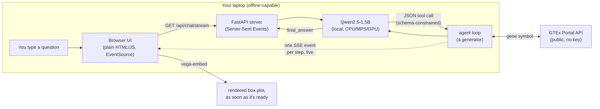

# local-inference-example

A short, hands-on demo: download a small open-weight model from Hugging
Face, run inference entirely on your own laptop (no API key, no internet
needed for the model itself after the first download), and wrap it in a
minimal tool-using ("agentic") loop that calls a real public bioinformatics
API - with a browser UI so you can watch it work.

Works on macOS and Windows/Linux, CPU-only by default.

## Quickstart

Requires [uv](https://docs.astral.sh/uv/getting-started/installation/)
(works the same on macOS and Windows).

```bash
git clone git@github.com:ccb-hms/local-inference-example.git
cd local-inference-example
uv sync
uv run local-inference-example
```

This starts a local web server and opens it in your browser
(http://127.0.0.1:8000). The model loads on your first question, not at
startup - that first response will take longer while it downloads (~3GB,
cached under `~/.cache/huggingface` for next time) and loads. Every question
after that still needs internet, since the tools query GTEx live.

## What it does

A chat panel on the left, a chart panel on the right. Ask about a gene (e.g.
*"where is BRCA1 expressed?"*) and the model - running entirely on your
laptop - decides which tools to call, in what order, to answer you. Every
tool call and its result is narrated into the chat *as it actually
happens*, over a real streaming connection - not a canned "typing" replay
of an already-finished response.



`run_agent_stream` in [agent.py](src/local_inference_example/agent.py) is a
Python generator that `yield`s each step the instant it's produced;
[server.py](src/local_inference_example/server.py) turns that into a
Server-Sent Events response, and the browser's `EventSource` renders each
one as it arrives. The chart itself appears the moment
`plot_gene_expression` finishes - not only once the whole run is done.

The model is [Qwen2.5-1.5B-Instruct](https://huggingface.co/Qwen/Qwen2.5-1.5B-Instruct),
small enough to run on a laptop CPU with no GPU required.

## The pipeline is four atomic tools, not one

A real gene-expression lookup isn't one opaque function - it's a chain of
distinct steps, each of which can be inspected (or fail) on its own. Each
is its own file in [tools/](src/local_inference_example/tools/), and each
step is narrated separately in the chat:

1. **`resolve_gene`** - a gene symbol like `BRCA1` isn't a stable ID; GTEx
   indexes by GENCODE ID. This step looks it up (and is where a typo or a
   made-up gene name fails, cleanly).
2. **`fetch_gene_expression`** - pure data acquisition: pulls real
   per-sample TPM values for that gene across all ~54 GTEx tissues.
3. **`summarize_expression`** - turns the fetched data into a plain-text
   summary (highest-expressing tissue, tissue-specificity ratio).
4. **`plot_gene_expression`** - turns the same fetched data into an
   interactive [Altair](https://altair-viz.github.io/) box plot instead -
   the real per-sample distribution, not just a single median bar. Takes an
   optional `highlight_tissue` argument - ask something like *"where is INS
   expressed, highlight the pancreas"* and the model can call it out in red.

Each step resolves/fetches what it needs itself if the model calls them out
of order (or skips straight to `plot_gene_expression`), rather than failing.
There's no caching, on purpose: every call really hits GTEx (each takes well
under a second), so the API URL shown in the chat is always the real
request that ran. A fifth tool, `get_time`, exists purely to show that not
every tool call has to hit a public API.


Every step - including the model's final answer - is narrated as a colored
chat bubble: yellow for the call itself, purple for the exact API URL it hit
(ellipsis-truncated, hover for the full thing), green for the data that came
back, blue for the answer. Click any bubble (or just watch as they appear)
and a panel below the chart shows exactly what that step really did - the
tool's actual Python source for a yellow bubble, the request broken into
method/endpoint/params for a purple one, the real JSON GTEx returned for a
green one - color-coded to match. Nothing here is simulated or summarized
after the fact: it's the same `ToolResult` object the agent loop used,
serialized straight into the stream.

## The model is only told what skills/*.md says

[agent.py](src/local_inference_example/agent.py) doesn't hardcode a
tool-description string. At startup it reads every file in
[skills/](src/local_inference_example/skills/) - one markdown file per
tool, with a `tool` / `description` / `call` frontmatter block - and builds
the "Available tools" section of the system prompt from that. The code
(`tools/`) and what the model is told about it (`skills/`) are separate,
individually editable pieces, closer to how a real agent framework (MCP
tool descriptions, Claude Skills) separates them than a single hardcoded
prompt string would be. Edit a `skills/*.md` file and the model's
instructions change - no Python edit required.

Every JSON object the model emits is additionally constrained by
[outlines](https://github.com/dottxt-ai/outlines) to match a
[pydantic](https://docs.pydantic.dev/) schema (`AgentStep` in
[agent.py](src/local_inference_example/agent.py)) - so it's guaranteed to
be a syntactically well-formed tool call or final answer, no regex-parsing
of free-form text required. It can still pick the *wrong* tool, or waste a
step on `get_time` - the schema guarantees syntax, not judgment.

## Swapping in a different model

```bash
uv run local-inference-example --model-size 0.5b   # ~1GB, faster, less reliable
uv run local-inference-example --model-size 1.5b    # default
```

`Qwen/Qwen2.5-0.5B-Instruct` still produces syntactically valid tool calls
(that's what the JSON schema constraint guarantees), but noticeably more
often skips a step or loops instead of giving a final answer - a good
illustration of the difference between constraining a model's *syntax*
versus its *judgment*. For any other model, change `MODEL_SIZES` in
[model.py](src/local_inference_example/model.py).

## Workshop notes

This is deliberately minimal: one small model, five tools, no agent
framework, no database. The point is to show what an "agent loop" actually
is under the hood - a prompt built from markdown files, a JSON schema, and
a `while` loop - before reaching for something like LangChain or an MCP
server.

A few things worth calling out live:

- **Constrained decoding vs. model judgment.** The `AgentStep` schema
  guarantees the model's output always parses as valid JSON. It does not
  guarantee the model calls the tools in a sensible order, or stops once it
  has enough information - see [agent.py](src/local_inference_example/agent.py)'s
  stall-detection fallback, which exists because even Qwen2.5-1.5B
  occasionally re-issues the same tool call instead of answering.
- **Step limits are a real safety mechanism, not boilerplate.** `MAX_STEPS`
  in [agent.py](src/local_inference_example/agent.py) caps how many tool
  calls one query can trigger - without it, a confused small model can loop
  indefinitely. Splitting one tool into four raises the minimum number of
  steps a correct answer needs, so `MAX_STEPS` had to grow with it.
- **The model never sees your data go anywhere except GTEx.** The LLM runs
  entirely on your machine; the only network calls are the tools' requests
  to the public GTEx API, and they only ever send a gene symbol - no
  personal data, no query text.
- **The tool result is real; the model's commentary on it might not be.**
  The gene symbol, tissue names, and TPM values in each Observation come
  straight from GTEx. But ask it to "pick a gene associated with
  Alzheimer's" and it may confidently name one that isn't - there's no
  search-by-disease tool, so that step is unconstrained model guesswork,
  not grounded data. The schema constrains the *shape* of every tool call,
  not the *judgment* behind picking `gene='ALDH7A1'` over the real
  Alzheimer's genes (`APOE`, `APP`, `PSEN1`/`PSEN2`, `TREM2`). Worth
  pairing every number the model reports with the chart, not just its
  prose - and worth asking a workshop audience which parts of an answer
  they'd trust and which they'd check.

## Why outlines, and not the model's native tool-calling format?

Qwen2.5-Instruct ships its own tool-calling convention: pass `tools=` to
`tokenizer.apply_chat_template`, and the model free-generates a
`<tool_call>{"name": ..., "arguments": {...}}</tool_call>` block that you
parse yourself. That's a real alternative to outlines' constrained
decoding, so it's worth asking whether outlines is pulling its weight -
"native format, then validate with pydantic" is simpler and needs one
fewer dependency.

We prototyped it (`src/local_inference_example/native_model.py`) and
measured how often raw output validated against the same `AgentStep`
schema on the *first try*, no retries, 8 samples per query
(`scripts/compare_failure_rates.py`):

| Model | outlines (constrained) | native `<tool_call>` + pydantic |
|---|---|---|
| Qwen2.5-1.5B-Instruct (default) | 32/32 (100%) | 32/32 (100%) |
| Qwen2.5-0.5B-Instruct | 32/32 (100%) | 24/32 (75%) |

At the default 1.5B size, both approaches were equally reliable - outlines
isn't buying anything on raw JSON-conformance there. At 0.5B, every native
failure was the same shape: for a zero-argument tool (`get_time`), the
model emitted `{"name": "get_time"}` and omitted the required `"arguments"`
key entirely, which the Hermes tool-calling spec (and our validator)
requires as `"arguments": {}`. Outlines can't produce that failure - the
grammar makes an empty-but-present `arguments` object structurally
unavoidable, regardless of model size.

That specific 0.5B failure turned out to be promptable away: adding one
sentence to the system prompt ("every tool call must include an
`arguments` object, even for a tool with no parameters") took native's
0.5B score from 24/32 back to 32/32. Which is the actual tradeoff: native
+ pydantic validation *can* match outlines, but only after you've
discovered the failure mode empirically and patched the prompt for it.
Outlines rules the whole category out by construction, before you've
written a single test case - that's what "guarantees valid syntax
regardless of model size" (see the note above `DEFAULT_MODEL` in
[model.py](src/local_inference_example/model.py)) is actually buying you.
