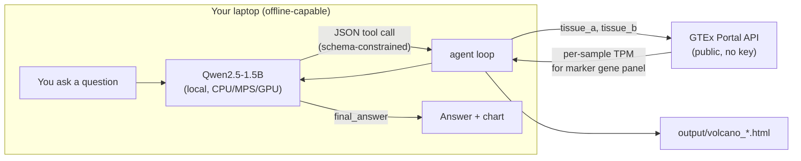
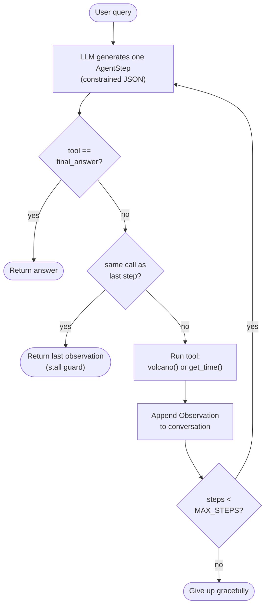

# local-inference-example

A short, hands-on demo for the CCB "APIs and Local Inference" workshop
([AI-45](https://ccb-hms.atlassian.net/browse/AI-45)): download a small
open-weight model from Hugging Face, run inference entirely on your own
laptop (no API key, no internet needed for the model itself after the first
download), and wrap it in a minimal tool-using ("agentic") loop that calls a
real public bioinformatics API.

Works on macOS and Windows/Linux, CPU-only by default.

## What it does

The model is [Qwen2.5-1.5B-Instruct](https://huggingface.co/Qwen/Qwen2.5-1.5B-Instruct)
(~3GB download), small enough to run on a laptop CPU with no GPU required.
It's wrapped in a tiny tool-calling loop ([agent.py](src/local_inference_example/agent.py))
that lets the model call two tools ([tools.py](src/local_inference_example/tools.py)):

- `volcano(tissue_a, tissue_b)` - pulls real per-sample expression data for a
  panel of tissue-marker genes from the [GTEx Portal API](https://gtexportal.org/home/api-docs/index.html)
  (a public REST API, no key required), computes log2 fold change and a
  Mann-Whitney significance test for each gene, and saves an interactive
  [Altair](https://altair-viz.github.io/) volcano plot - so you get a picture
  to check your answer against, not just a number.
- `get_time()` - real-world state the model can't know on its own.

Ask it something like `compare gene expression between blood and pancreas`
and watch it call the `volcano` tool, then explain what came back.



Every JSON object the model emits is constrained by
[outlines](https://github.com/dottxt-ai/outlines) to match a
[pydantic](https://docs.pydantic.dev/) schema ([agent.py](src/local_inference_example/agent.py):`AgentStep`) -
so it's guaranteed to be a syntactically well-formed tool call or final
answer, no regex-parsing of free-form text required. `tissue_a`/`tissue_b`
are further constrained to a curated list of valid GTEx tissue names (see
`Tissue` in [agent.py](src/local_inference_example/agent.py)), so the model
can't just make up a tissue that doesn't exist. It can still pick a *wrong*
(but valid) tissue, or waste a step on `get_time` - the schema guarantees
syntax, not judgment.



## Setup

Requires [uv](https://docs.astral.sh/uv/getting-started/installation/)
(works the same on macOS and Windows).

```bash
git clone git@github.com:ccb-hms/local-inference-example.git
cd local-inference-example
uv sync
```

## Run

```bash
uv run local-inference-example
```

The first run downloads the model from Hugging Face (~3GB) and caches it
under `~/.cache/huggingface`; later runs start instantly offline (the
`volcano` tool still needs internet, since it queries GTEx live). Each
`volcano` call writes an interactive chart to `output/volcano_<a>_vs_<b>.html`
- open it in a browser to check the model's answer against the actual data.

## Swapping in a different model

Change `DEFAULT_MODEL` in [model.py](src/local_inference_example/model.py) to
any small instruct model on the Hugging Face Hub. Worth trying live in a
workshop: dropping to `Qwen/Qwen2.5-0.5B-Instruct` (~1GB) still produces
syntactically valid tool calls (that's what the JSON schema constraint
guarantees), but noticeably more often picks the wrong tissue or loops
instead of giving a final answer - a good illustration of the difference
between constraining a model's *syntax* versus its *judgment*.

## Workshop notes

This is deliberately minimal: one small model, two tools, no agent
framework. The point is to show what an "agent loop" actually is under the
hood - a prompt, a JSON schema, and a `while` loop - before reaching for
something like LangChain or an MCP server.

A few things worth calling out live:

- **Constrained decoding vs. model judgment.** The `AgentStep` schema
  guarantees the model's output always parses as valid JSON and names a real
  tissue. It does not guarantee the model picks the *right* tissue, or that
  it stops calling tools once it has enough information - see
  [agent.py](src/local_inference_example/agent.py)'s stall-detection
  fallback, which exists because even Qwen2.5-1.5B occasionally re-issues
  the same tool call instead of answering.
- **Step limits are a real safety mechanism, not boilerplate.** `MAX_STEPS`
  in [agent.py](src/local_inference_example/agent.py) caps how many tool
  calls one query can trigger - without it, a confused small model can loop
  indefinitely.
- **TPM normalization has a compositional side effect.** Compare
  `Whole_Blood` vs `Pancreas`: the housekeeping genes `ACTB`/`GAPDH` show up
  as strongly "downregulated" in pancreas, even though nothing about their
  actual transcription changed. Insulin (`INS`) is so dominant in pancreas
  that it crowds out every other gene's *share* of the transcriptome under
  TPM's sum-to-one-million normalization. It's a good prompt for discussing
  why RNA-seq analyses often reach for a size-factor method (e.g. DESeq2,
  TMM) instead of raw TPM when testing for differential expression.
- **The model never sees your data go anywhere except GTEx.** The LLM runs
  entirely on your machine; the only network call is the `volcano` tool's
  request to the public GTEx API, and it only ever sends tissue names - no
  gene lists, no personal data, no query text.
- **The tool result is real; the model's commentary on it might not be.**
  The gene symbols, log2FC values, and p-values in the Observation come
  straight from GTEx. But ask the model to explain what a gene symbol
  stands for and a small model will confidently expand it wrong (e.g.
  misnaming `SFTPC`, surfactant protein C) - the schema constrains the
  *data*, not the model's *knowledge*. Worth pairing every number the model
  reports with the chart, not just its prose.
